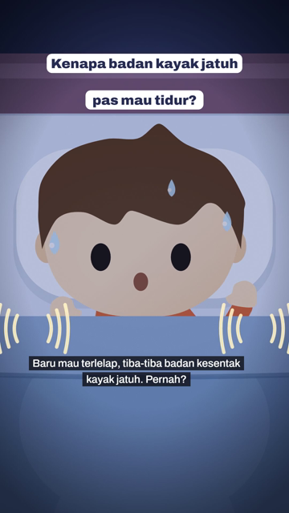
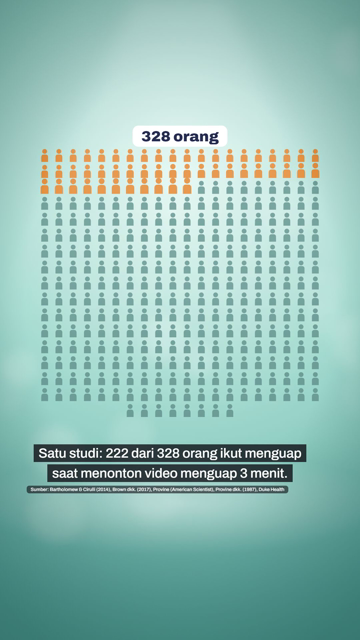
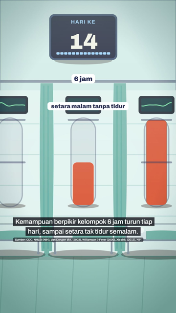
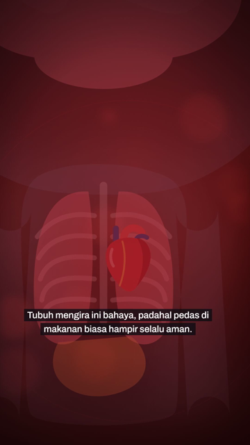
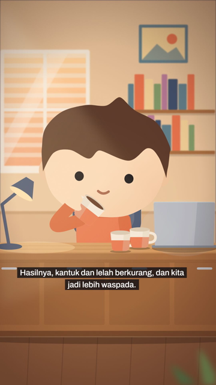
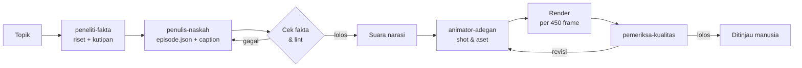

<div align="center">

# Bedah Dikit

**Semua hal, kita bedah.**

Pabrik video Shorts edukasi berbahasa Indonesia: dari satu pertanyaan "kenapa?" sampai video vertikal siap tayang, dikerjakan oleh tim agent AI dan dirender dengan [Remotion](https://www.remotion.dev/).

YouTube · Instagram · TikTok — **@bedahdikit**

<br>







</div>

---

## Apa ini?

Bedah Dikit menjelaskan fenomena sehari-hari lewat animasi pendek bersama **Raka**, tokoh utama channel. Setiap episode ditulis sebagai satu file `episode.json`. Dari file itu, pipeline membuat suara narasi, menyusun adegan, merender video 1080×1920, lalu menyiapkan caption untuk tiap platform.

Prinsip yang dijaga di setiap video:

- **Fakta dulu.** Setiap angka dan sebab-akibat harus didukung minimal dua sumber yang dibaca penuh, dengan kutipan asli. Perkiraan ditulis sebagai perkiraan, dugaan ditulis sebagai dugaan.
- **Satu gaya.** Warna, tokoh, gerak, dan tata letak teks mengikuti satu standar, jadi semua episode terasa satu keluarga.
- **Manusia yang memutuskan.** Agent tidak pernah mengunggah apa pun. Setiap video ditinjau dulu sebelum tayang.

## Episode

| Judul | Durasi | Slug |
|---|---|---|
| Kenapa Badan Tiba-tiba Kayak Jatuh pas Mau Tidur? | 53 dtk | `tersentak-tidur` |
| Kenapa Menguap Bisa Menular? | 54 dtk | `menguap-menular` |
| Apa Jadinya Kalau Kita Begadang Terus? | 77 dtk | `begadang-terus` |
| Kenapa Makan Pedas Bikin Ketagihan padahal Sakit? | 89 dtk | `pedas-ketagihan` |
| Apa Jadinya Kalau Kita Kebanyakan Kafein? | 87 dtk | `kebanyakan-kafein` |

Topik berikutnya antre di [`antrean.md`](antrean.md).

## Cara kerjanya



Sesi utama Claude Code berperan sebagai **sutradara**: membagi tugas, memeriksa setiap laporan, dan menjadi satu-satunya penghubung ke pemilik channel.

| Agent | Tugas |
|---|---|
| `peneliti-fakta` | Meriset topik dan memeriksa setiap klaim |
| `penulis-naskah` | Menulis `episode.json` dan caption |
| `animator-adegan` | Membangun shot, set, properti, dan gerak tokoh |
| `penata-suara` | Mengatur narasi dan efek suara, lalu mengukurnya |
| `operator-render` | Memulihkan render yang gagal |
| `pemeriksa-kualitas` | Menilai video akhir: fakta, area aman, ekspresi, audio |
| `analis-gaya` | Membandingkan gaya video dengan referensi |

Definisi agent ada di [`.claude/agents/`](.claude/agents/). Alur lengkapnya ada di skill [`episode-baru`](.claude/skills/episode-baru/SKILL.md), dan standar visualnya di skill [`gaya-video`](.claude/skills/gaya-video/SKILL.md).

## Struktur folder

```
episodes/<slug>/        episode.json, caption.md, dan suara/ per episode
src/Episode.tsx         penyaji episode dari episode.json
src/pustaka/            rig tokoh, properti, ikon, dan set adegan
  set/                  ruang, interior, organ, mikro, lab, belah, wahana, ...
scripts/                pipeline: suara, render, lint, ringkasan, lembar kontak
data/                   profil suara dan efek suara
.claude/agents/         tim agent
.claude/skills/         skill episode-baru dan gaya-video
docs/cuplikan/          gambar untuk README ini
```

## Menjalankan

Butuh Node.js 18 atau lebih baru.

```bash
npm install
cp .env.example .env    # isi ELEVENLABS_API_KEY untuk suara Raka
```

| Perintah | Gunanya |
|---|---|
| `node scripts/episode.mjs <slug> --cek` | Membuat suara yang belum ada, menghitung durasi, dan merender still per adegan |
| `node scripts/render-episode.mjs <slug>` | Render penuh dengan cek disk, log, durasi, dan audio. Hasilnya `out/episode/<slug>/video.mp4` |
| `node scripts/lint-episode.mjs <slug>` | Memeriksa aturan yang bisa dihitung: panjang teks, angka, sumber, efek |
| `node scripts/ringkas-naskah.mjs <slug> --shot` | Ringkasan naskah dan shot dengan detik mulai |
| `node scripts/lembar-kontak.mjs <slug>` | Grid frame dari video untuk pemeriksaan visual |
| `npm run studio` | Membuka Remotion Studio |

Render dilakukan per 450 frame dan bagian yang gagal diulang otomatis, jadi aman dijalankan di laptop dengan memori terbatas.

## Dibuat dengan

[Remotion](https://www.remotion.dev/) · React · TypeScript · [ElevenLabs](https://elevenlabs.io/) untuk suara narasi · [Claude Code](https://claude.com/claude-code) untuk tim agent
