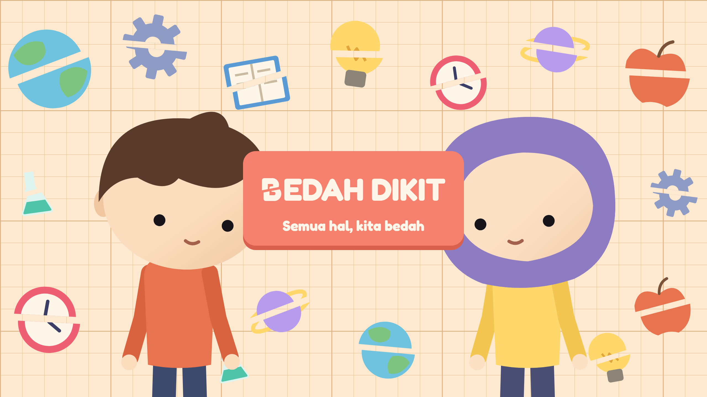
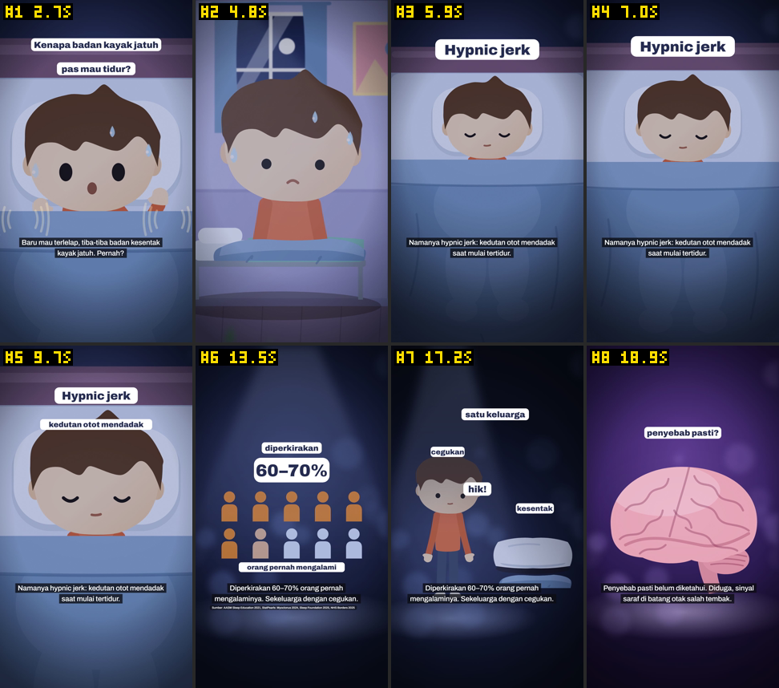

<p align="center">
  
</p>

<div align="center">

[](package.json)
[](package.json)
[](package.json)
[](tsconfig.json)
[](data/suara.json)
[](.claude/agents)
[](https://www.youtube.com/@bedahdikit)

# Bedah Dikit

### Pabrik video Shorts edukasi: dari satu pertanyaan "kenapa?" sampai video siap tayang.

**Bukan template, tapi tim.** Tujuh agent Claude Code bekerja seperti kru produksi kecil. Ada yang meriset dan mengecek fakta, menulis naskah, menganimasikan adegan, mengatur suara, sampai menilai hasil akhir. Satu sesi bertindak sebagai sutradara, dan manusia yang memutuskan video mana yang tayang.

[Tampilan](#tampilan) · [Mulai cepat](#mulai-cepat) · [Membuat episode](#membuat-episode) · [Cara kerja](#cara-kerja) · [Konfigurasi](#konfigurasi) · [FAQ](#faq)

<code>npm install && node scripts/render-episode.mjs begadang-terus</code>

</div>

---

## Tampilan

### Hook di detik pertama, data yang jujur

| **Hook frame 0** | **Data dari sumber** |
|:--|:--|
| <a href="docs/cuplikan/tersentak-tidur.png"></a> | <a href="docs/cuplikan/menguap-menular.png"></a> |
| *Kenapa badan kayak jatuh pas mau tidur?* Video dibuka langsung di momen yang bikin penonton merasa "aku banget", tanpa salam pembuka. | *Kenapa menguap bisa menular?* Angka tampil dalam satuan sumbernya, 222 dari 328 orang, lengkap dengan baris sumber. |

### Set yang dibangun untuk tiap topik

| **Lab** | **Tubuh tembus pandang** | **Interior** |
|:--|:--|:--|
| <a href="docs/cuplikan/begadang-terus.png"></a> | <a href="docs/cuplikan/pedas-ketagihan.png"></a> | <a href="docs/cuplikan/kebanyakan-kafein.png"></a> |
| *Begadang terus.* Meter tumbuh dari nol dalam satuan studi. | *Pedas bikin ketagihan.* Organ dan alarm tubuh. | *Kebanyakan kafein.* Ruang kerja, kafe, dan klinik. |

Klik gambar mana pun untuk melihat ukuran penuh.

### Pemeriksaan tanpa menonton satu per satu

<a href="docs/cuplikan/lembar-kontak.png"></a>

`lembar-kontak.mjs` menyusun satu frame per shot menjadi grid bernomor dan berdetik. Agent pemeriksa menilai teks terpotong, wajah tertutup, area aman, dan kecocokan gambar dengan narasi dari lembar ini, bukan dari ratusan frame terpisah.

### Status episode

| | Episode | Durasi | Slug |
|:--|:--|:--|:--|
| 🟡 | Kenapa Badan Tiba-tiba Kayak Jatuh pas Mau Tidur? | 53 dtk | `tersentak-tidur` |
| 🟡 | Kenapa Menguap Bisa Menular? | 54 dtk | `menguap-menular` |
| 🟢 | Apa Jadinya Kalau Kita Begadang Terus? | 77 dtk | `begadang-terus` |
| 🟢 | Kenapa Makan Pedas Bikin Ketagihan padahal Sakit? | 89 dtk | `pedas-ketagihan` |
| 🟢 | Apa Jadinya Kalau Kita Kebanyakan Kafein? | 87 dtk | `kebanyakan-kafein` |

🟢 tayang · 🟡 menunggu review · ⚪ antre di [`antrean.md`](antrean.md)

---

## Mulai cepat

### Prasyarat

- **Node.js 24** atau lebih baru (`node -v` untuk mengecek)
- Ruang disk kosong minimal **2 GB** untuk render
- **Kunci API ElevenLabs** untuk suara Raka. Tanpa kunci, suara yang sudah ada tetap bisa dipakai.
- **Claude Code**, jika ingin membuat episode baru dengan tim agent

### 1. Clone dan pasang dependensi

```bash
git clone https://github.com/ryanmhildan/bedah-dikit.git
cd bedah-dikit
npm install
```

### 2. Isi kunci suara

```bash
cp .env.example .env
```

Buka `.env`, lalu isi `ELEVENLABS_API_KEY` dengan kunci `sk_` milikmu.

### 3. Render satu episode

```bash
node scripts/render-episode.mjs begadang-terus
```

Hasilnya ada di `out/episode/begadang-terus/video.mp4`. Kalau terminal mencetak **LOLOS**, video sudah dicek: durasinya cocok, stempel waktunya baru, dan ada aliran audio AAC.

> [!NOTE]
> MP3 narasi tidak ikut disimpan di repo. Render pertama akan membuatnya ulang dari `ucap` di `episode.json`, dan itu memakai kredit ElevenLabs.

---

## Membuat episode

### Langkah 1: Pilih topik

Tulis topik di [`antrean.md`](antrean.md), atau langsung berikan ke Claude Code. Topik yang paling cocok adalah fenomena tubuh sehari-hari yang aneh, dengan judul pendek berbentuk "Kenapa ...?".

### Langkah 2: Jalankan skill `episode-baru`

Buka Claude Code di folder ini, lalu kirim:

```
/episode-baru Kenapa badan tiba-tiba kayak jatuh pas mau tidur?
```

Sutradara menjalankan 14 langkah: riset, cek kutipan, naskah, lint, suara, shot, cek still, render, QA, dan revisi. Ada dua titik persetujuan, yaitu setelah naskah jadi dan setelah video jadi.

### Langkah 3: Tinjau naskah

Saat naskah dan suara selesai, sutradara mengirim ringkasan baris beserta durasinya. Di titik ini masih murah untuk mengubah isi, karena shot belum dibangun.

### Langkah 4: Tinjau video

Video dikirim bersama temuan QA dan daftar hal yang **belum** terverifikasi, misalnya gerakan yang belum ditonton utuh atau audio yang belum didengar. Kamu yang memutuskan: tayang, revisi, atau buang.

<details>
<summary><b>Seperti apa <code>episode.json</code>?</b> (klik untuk membuka)</summary>

Satu episode adalah daftar adegan. Setiap adegan berisi baris narasi, dan setiap baris punya `teks` untuk layar, `ucap` untuk suara, serta `shot` untuk visual.

```json
{
  "judul": "Kenapa Badan Tiba-tiba Kayak Jatuh pas Mau Tidur?",
  "tokoh": "raka",
  "musik": false,
  "sumber": [{ "nama": "AASM Sleep Education 2021", "url": "https://sleepeducation.org/sleep-disorders/sleep-starts/" }],
  "adegan": [
    { "id": "buka", "jenis": "pembuka",
      "baris": [
        { "id": "buka-1",
          "teks": "Baru mau terlelap, tiba-tiba badan kesentak kayak jatuh. Pernah?",
          "ucap": "Baru mau terlelap, tiba-tiba badan kesentak kayak jatuh. Pernah?",
          "shot": [{ "set": "ruang", "suasana": "malam", "properti": [{ "nama": "kasur" }, { "nama": "selimut", "varian": "atas" }] }]
        }
      ]
    }
  ]
}
```

Angka di `ucap` ditulis sebagai kata ("enam puluh persen"), supaya suara tidak salah membaca.

</details>

<details>
<summary><b>Alat hemat token</b> (dipakai agent supaya tidak membaca file besar)</summary>

| Perintah | Gunanya |
|:--|:--|
| `node scripts/ringkas-naskah.mjs <slug> --shot` | Naskah dan shot dalam satu ringkasan berdetik, sekitar sepersepuluh ukuran `episode.json` |
| `node scripts/lint-episode.mjs <slug>` | Aturan yang bisa dihitung: panjang teks, angka di `ucap`, sumber, set, durasi, jumlah efek |
| `node scripts/lembar-kontak.mjs <slug>` | Grid frame bernomor dari video. `--rapat` untuk tiga frame per shot, `--detik` untuk frame penuh |
| `node scripts/rapikan-naskah.mjs <slug>` | Menyimpan `episode.json` dalam format ringkas, satu shot per baris |

</details>

---

## Cara kerja

```
 topik ─▶ peneliti-fakta ─▶ penulis-naskah ─▶ lint + cek fakta ─▶ suara ElevenLabs
                            ▲                     │
                            └──── klaim gagal ────┘

 ─▶ animator-adegan ─▶ render per 450 frame ─▶ pemeriksa-kualitas ─▶ tinjauan manusia
          ▲                                           │
          └─────────────────── revisi ────────────────┘
```

1. **Riset.** `peneliti-fakta` membaca minimal dua sumber penuh untuk setiap klaim dan menyertakan kutipan asli. Sutradara mencocokkan ulang kutipan dengan sumber utamanya.
2. **Naskah.** `penulis-naskah` hanya memakai fakta yang lolos. Perkiraan ditulis sebagai perkiraan, dugaan ditulis sebagai dugaan.
3. **Suara.** `scripts/episode.mjs --cek` membuat MP3 per baris berdasarkan hash `ucap`, jadi baris yang tidak berubah tidak dibuat ulang.
4. **Visual.** `animator-adegan` menyusun shot dari pustaka set, properti, dan rig tokoh. Setiap perubahan pustaka diuji regresi ke episode lama sampai identik per byte.
5. **Render.** Video dirender per 450 frame dan bagian yang gagal diulang otomatis, lalu audio disusun tanpa Chrome.
6. **QA.** `pemeriksa-kualitas` memutuskan LOLOS, LOLOS dengan catatan, atau REVISI. Revisi maksimal dua putaran.

### Tim

| Agent | Tugas | Boleh mengubah |
|:--|:--|:--|
| `peneliti-fakta` | Meriset dan memeriksa klaim | Tidak ada |
| `penulis-naskah` | Menulis naskah dan caption | `episodes/` |
| `animator-adegan` | Membangun visual dan gerak | `src/Episode.tsx`, `src/pustaka/`, `src/tema.ts` |
| `penata-suara` | Mengatur dan mengukur audio | `data/suara.json`, `data/efek-suara.json` |
| `operator-render` | Memulihkan render yang gagal | Hanya hasil render |
| `pemeriksa-kualitas` | Menilai video akhir | Tidak ada |
| `analis-gaya` | Membandingkan gaya dengan referensi | Tidak ada |

### Struktur

```
episodes/<slug>/      episode.json, caption.md, dan suara/ per episode
src/
  Episode.tsx         penyaji episode dari episode.json
  tema.ts             palet warna bersama
  pustaka/
    tokoh-rig.tsx     rig Raka, Nadia, dan Bima: pose, mata, mulut, ekspresi
    properti.tsx      benda: kopi, kasur, ponsel, otak, stetoskop, ...
    set/              ruang, interior, organ, mikro, lab, tembus, belah, wahana
scripts/
  episode.mjs         suara, still, dan render per bagian
  render-episode.mjs  render penuh dengan verifikasi
  lint-episode.mjs    pemeriksa aturan naskah
.claude/
  agents/             tujuh agent
  skills/             episode-baru (alur) dan gaya-video (standar visual)
docs/                 banner dan cuplikan untuk README
```

---

## Konfigurasi

| Berkas | Isi |
|:--|:--|
| `.env` | `ELEVENLABS_API_KEY` untuk suara Raka |
| `data/suara.json` | Profil suara per tokoh: Raka (ElevenLabs), Nadia, dan Bima |
| `data/efek-suara.json` | Efek suara dan musik latar. Musik saat ini **mati** |
| `antrean.md` | Daftar topik dan statusnya: `antre`, `proses`, `menunggu review`, `selesai` |
| `.claude/skills/gaya-video/` | Standar gaya: naskah, visual, audio, dan pemeriksaan |

| Flag `episode.mjs` | Fungsi |
|:--|:--|
| `--cek` | Membuat suara yang belum ada, menghitung durasi, dan merender still per adegan |
| `--lanjut` | Melanjutkan render yang gagal di tengah, selama kode belum berubah |
| `--audio-saja` | Menyusun ulang audio tanpa merender gambar |

## Prinsip konten

- Setiap angka dan sebab-akibat didukung minimal **dua sumber** yang dibaca penuh, dengan kutipan asli.
- Jumlah peserta studi dicek: total semua eksperimen atau per kelompok.
- Grafik tumbuh dari nol dalam satuan sumbernya, supaya tidak terbaca sebagai persen.
- Topik kesehatan menyebut kapan perlu ke dokter.
- Agent tidak pernah mengunggah video, mengunduh musik, atau memakai akun tanpa persetujuan.

---

## FAQ

**Render berhenti di tengah tanpa pesan error.**
Chrome bisa berhenti diam-diam saat memori hampir habis. Jalankan `node scripts/render-episode.mjs <slug> --lanjut` untuk meneruskan dari bagian yang gagal. Kalau masih gagal, lihat `out/episode/<slug>/render.log`.

**Suara dibuat ulang padahal naskah tidak diubah.**
Suara dibuat ulang setiap kali `ucap` berubah, termasuk perbedaan satu tanda baca. Ubah `teks` saja kalau hanya ingin memperbaiki tulisan di layar.

**Kenapa ffmpeg tidak punya filter `drawtext` atau `tile`?**
ffmpeg bawaan Remotion versinya minimal. Karena itu `lembar-kontak.mjs` mengambil frame mentah lalu menyusun grid dan angkanya sendiri di Node.

**Bisakah dipakai untuk channel lain?**
Bisa. Ganti tokoh di `src/pustaka/tokoh-rig.tsx`, palet di `src/tema.ts`, dan standar gaya di `.claude/skills/gaya-video/`. Alur agent dan skrip render tidak bergantung pada topik.

**Kenapa tidak ada musik latar?**
Keputusan channel. Narasi lebih jelas tanpa musik, dan tidak ada risiko klaim hak cipta.

<hr>

<p align="center"><em>Penasaran itu murah.<br>
Bedah Dikit memberinya riset, naskah, dan animasi, supaya jawabannya muat dalam satu menit.</em></p>

<hr>

## Lisensi

Proyek pribadi. Silakan gunakan sebagai referensi dengan mencantumkan sumber.
